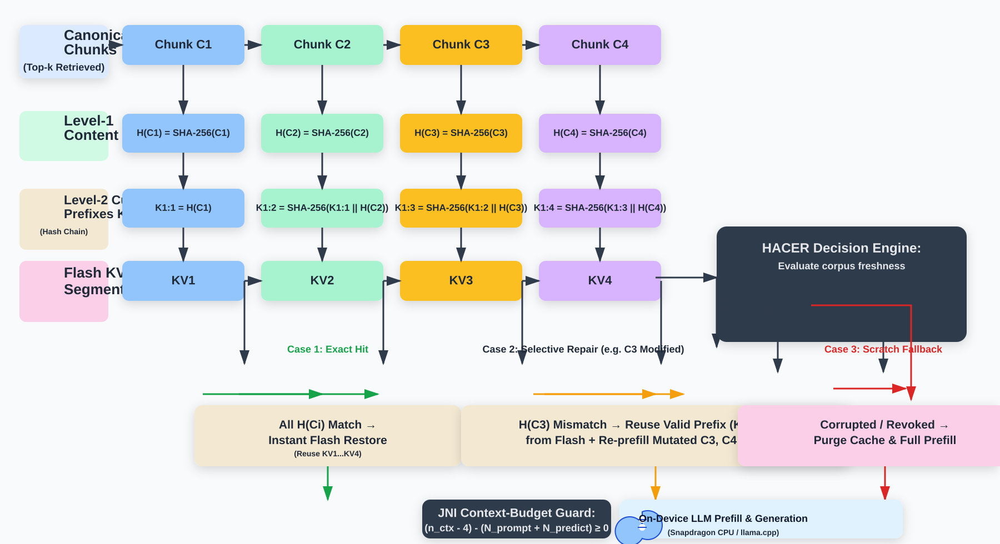

# HACER-RAG: Evidence-Version-Aware KV-Cache Reuse and Selective Repair for On-Device Retrieval-Augmented Generation

[](https://reactnative.dev/)
[](https://www.qualcomm.com/)
[](https://github.com/mybigday/llama.rn)
[-red.svg)](paper/hacer_rag_complete_paper.tex)
[](LICENSE)

---

## 📌 Overview

**HACER-RAG** is an efficient, safety-verified system for running Retrieval-Augmented Generation (RAG) completely **on-device** on resource-constrained commodity smartphones.

Running LLMs locally on mobile devices ensures complete privacy and zero cloud dependence, but suffers from severe prefill bottlenecks: processing hundreds of retrieved document tokens on a budget mobile CPU is expensive. HACER exploits the observation that retrieved evidence is often stable across turns, and that only a small portion of the context changes over time. Instead of re-prefilling the full retrieved context on every user request, HACER reuses valid resident KV-cache prefixes and repairs only the modified evidence segments.

HACER solves this with:
1. **Cryptographic Chunk Fingerprinting:** Deterministic SHA-256 evidence hashing across all retrieved context chunks.
2. **Canonical Evidence Ordering:** Consistent prefix alignment preventing cache fragmentation.
3. **Selective Invalidation & Repair:** Reuses valid prefix memory up to the earliest modification point and recalculates only changed chunks.
4. **Context Budget & Headroom Enforcement:** Strict runtime accounting guarding against OOM crashes and silent context truncation.

---

## 📊 Key Physical Results

Evaluated across **180 physical trials** on a **Xiaomi Redmi 12 5G** (Qualcomm Snapdragon 4 Gen 2, 4 GB RAM, Android 14) running **Gemma 2 2B**:

| Metric | Full Prefill (Baseline) | HACER (K=4 Chunks Cached) | Improvement |
| :--- | :---: | :---: | :---: |
| **Prefill Latency** | 54.91 ± 1.15 s | **7.46 ± 0.08 s** | **86.4% Reduction** ($p < 10^{-68}$) |
| **End-to-End Latency** | 60.10 ± 1.25 s | **16.48 ± 0.17 s** | **3.65× Speedup** |
| **Factual Accuracy** | 100% | **100%** | Zero Concordance Loss |
| **Staleness Handling** | 0% (Silent Hallucinations) | **100% Repaired** | Zero Stale Hallucinations |
| **Cache Load Overhead** | N/A | **256 ms** | Flash I/O is **>150× faster** than CPU compute |

---

## 🏗️ System Architecture

```
                          [ Incoming User Query ]
                                     │
                                     ▼
                   [ On-Device Vector Store Retrieval ]
                                     │
                                     ▼
              [ Evidence Atoms with SHA-256 Fingerprints ]
                                     │
                                     ▼
                   [ Canonical Prefix Layout Engine ]
                                     │
                                     ▼
              [ Evidence-Version Matcher (HACER Policy) ]
                 ├── Exact Prefix Match?  ──► Load Resident KV-Cache (~256 ms)
                 └── Modified Chunks?     ──► Selective Invalidation & Splicing
                                     │
                                     ▼
                   [ Context Budget Safety Guard ]
                                     │
                                     ▼
                  [ llama.rn / llama.cpp Native Core ]
                                     │
                                     ▼
                     [ Verified, Low-Latency Output ]
```

## 🧠 HACER Evidence-Version Flow

<p align="center">
  
</p>

---

## 📁 Repository Structure

```
├── chat/                   # React Native mobile application
│   ├── android/            # Native Android project with custom JNI telemetry
│   │   └── app/src/main/java/com/chat/DeviceTelemetryModule.kt
│   ├── screens/            # UI components (Chat, Documents, Settings)
│   ├── utils/              # Core logic & algorithms
│   │   ├── hacerPhase1.ts  # HACER Phase 1 prefix reuse orchestrator
│   │   ├── rag/            # Evidence chunker, embedder, vector store, certificates
│   │   └── inferenceController.ts  # Token budget & safety guards
│   └── package.json
│
├── benchmark/              # Empirical evaluation & benchmarking harness
│   ├── run_hacer_scaling_matrix.py      # 180-trial scaling matrix runner
│   ├── run_hacer_multichunk_rag.py      # Multi-hop RAG repeated trials
│   ├── analyze_context_invariance.py    # Two-way ANOVA statistical model
│   ├── audit_scaling_records.py         # Full JSONL raw telemetry auditor
│   └── results/                         # Physical benchmark outputs & JSONL logs
│
├── paper/                  # Complete academic research paper package
│   ├── hacer_rag_complete_paper.tex     # Standalone IEEEtran LaTeX manuscript
│   ├── main.tex                         # Modular LaTeX project entry point
│   ├── sections/                        # 17 individual section files
│   ├── figures/                         # Publication-quality vector & raster plots
│   └── references.bib                   # Audited bibliographic citations
│
└── research/               # Experimental protocols, blueprint, and audit logs
    ├── HACER_RAG_RESEARCH_BLUEPRINT.md
    ├── HACER_SCALING_MATRIX_180_TRIALS_REPORT.md
    └── STAGE_C1_1_FINAL_TELEMETRY_AUDIT.md
```

---

## 🚀 Getting Started

### 1. Prerequisites
- **Node.js** >= 18
- **Python** >= 3.10 (with `numpy`, `scipy`, `matplotlib`)
- **Android SDK** & **NDK** (for mobile compilation)
- **LaTeX** (TeXLive / MacTeX / MikTeX) with `pdflatex` or `latexmk`

### 2. Running Benchmarks
To reproduce the scaling benchmarks and audit the results:

```bash
# Run the 180-trial physical scaling matrix
python benchmark/run_hacer_scaling_matrix.py

# Run the multi-chunk RAG factual evaluation
python benchmark/run_hacer_multichunk_rag.py

# Audit all physical JSONL telemetry records
python benchmark/audit_scaling_records.py

# Run Two-Way ANOVA context-capacity invariance analysis
python benchmark/analyze_context_invariance.py
```

### 3. Compiling the LaTeX Paper
To build the IEEE conference paper:

```bash
cd paper
pdflatex hacer_rag_complete_paper.tex
bibtex hacer_rag_complete_paper
pdflatex hacer_rag_complete_paper.tex
pdflatex hacer_rag_complete_paper.tex
```

### 4. Running the Mobile App
To build and deploy the React Native app to an Android device:

```bash
cd chat
npm install
npx react-native run-android
```

---

## 📜 Citation

If you use HACER-RAG in your research, please cite:

```bibtex
@article{ahmed2026hacer,
  title     = {HACER-RAG: Evidence-Version-Aware KV-Cache Reuse and Selective Repair for On-Device Retrieval-Augmented Generation},
  author    = {Ahmed, Rayyan},
  journal   = {IEEE Transactions on Mobile Computing (Under Review)},
  year      = {2026}
}
```

---

## 📄 License

This project is licensed under the Apache License 2.0 - see the [LICENSE](LICENSE) file for details.

